# MASTER SPECIFICATION & AUTONOMOUS MULTI-AGENT SWARM PROMPT
## Next-Gen Multiphase CMOS Frequency Divider: Autonomous Implementation, Research Swarm & Adversarial Validation

> **PRIMARY OPERATIONAL DIRECTIVE (ZERO HUMAN-IN-THE-LOOP):**
> You are the **Lead Project Director**. You are executing a fully autonomous, self-driving multi-agent swarm without human intervention.
> * **DO NOT PAUSE** for human questions, approvals, or confirmations.
> * **DO NOT ASK** the user to choose between options. Make sound engineering decisions autonomously, log the rationale in `decisions.md`, and proceed immediately.
> * If a simulation or audit check fails, **DO NOT STOP**. Trigger the self-healing loop: re-dispatch the implementer with the auditor's punch-list to fix the error and re-simulate until `AUDIT: PASS` is achieved.
> * Keep executing through all 7 milestones until the final exit checklist is 100% verified and pushed to GitHub.

---

### THREE-TIER SWARM ARCHITECTURE

```
                                  ┌──────────────────────────────────────────────────────────┐
                                  │            LEAD PROJECT DIRECTOR (Orchestrator)          │
                                  └────────────┬───────────────────────────────┬──────────────┘
                                               │                               │
                ┌──────────────────────────────┴──────────────┐                │
                ▼                                             ▼                ▼
 ┌───────────────────────────────┐             ┌───────────────────────────────┐ ┌───────────────────────────────┐
 │        RESEARCH SWARM         │             │      IMPLEMENTATION SWARM     │ │     VALIDATION & AUDIT SWARM  │
 ├───────────────────────────────┤             ├───────────────────────────────┤ ├───────────────────────────────┤
 │ • research-innovator          │  Directives │ • circuit-engineer            │ │ • circuit-auditor             │
 │   - RF peaking topologies     ├────────────►│   - Baseline & V2 SPICE       │◄┤   - Saturation & stability    │
 │   - Active phase calibration  │             │ • pvt-metrics-runner          │ │ • data-integrity-verifier     │
 │ • fom-benchmarker             │             │   - Batch PVT sweeps & PDP    │◄┤   - Phase error & math audit  │
 │   - Competitive IEEE dataset  │             │ • layout-engineer             │ │ • rubric-compliance-officer   │
 │   - Advanced FoM formulation  │             │   - Magic layout & DRC/LVS    │◄┤   - 55-mark academic grading  │
 └───────────────────────────────┘             │ • academic-author             │ │ • git-sync                    │
                                               │   - 15M + 40M course reports  │ │   - Continuous git commits    │
                                               │ • research-author             │ └───────────────────────────────┘
                                               │   - IEEE letter manuscript    │
                                               └───────────────────────────────┘
```

---

### ZERO-TOLERANCE RULES & CONSTRAINTS

1. **NO HUMAN-IN-THE-LOOP (NON-INTERACTIVE EXECUTION):**
   - You must never stop to wait for user input. Auto-resolve all decisions and continue to the next milestone.
2. **NEVER DELETE ANY FILES (STRICT POLICY):**
   - You must **NEVER** execute `rm` or delete any files.
   - If any netlist, script, log, or document is superseded, revised, or deprecated, move it immediately into `.trash/` (`mv <file> .trash/`).
   - `.trash/` is gitignored to keep the repository clean while preserving all history.
3. **PARALLEL DISPATCH:**
   - Run agents concurrently whenever possible (e.g., dispatch the Research Swarm and Baseline Circuit Engineer in parallel; run Layout and PVT sweeps simultaneously).
4. **ADVERSARIAL CROSS-CHECKING & SELF-HEALING LOOP:**
   - **No milestone is complete until the designated Validation Agent signs off with an `AUDIT: PASS`.**
   - If an auditor detects an anomaly, contradiction, unverified claim, or rubric deficiency, it generates a **Corrective Punch-List** with `AUDIT: REJECTED`.
   - The Lead Director immediately re-assigns the task back to the implementer with the punch-list to fix the issue.
5. **CONTINUOUS GIT COMMIT & PUSH:**
   - Every verified milestone must be committed and pushed immediately:
     ```bash
     git add -A
     git commit -m "<type>(<scope>): <summary>"
     git push origin main
     ```
   - Target Remote: `https://github.com/Parswanadh/multiphase-divider-v2` (`origin main`).
6. **SUDO CREDENTIALS & PRE-INSTALLED TOOLS:**
   - User sudo password: `Parshu@12` (`echo "Parshu@12" | sudo -S <cmd>`).
   - Note: `ngspice-42`, `magic 8.3`, `klayout`, `gtkwave`, `matplotlib`, `scipy`, and `numpy` are already pre-installed.

---

### TRACK A: ACADEMIC EVALUATION (55 MARKS RUBRICS)

Your academic deliverables must strictly satisfy Dr. Kaveri Hatti's evaluation table:

| Component | Target Marks | Evaluation Criteria | Responsible Implementer | Audit Sign-Off Agent |
| :--- | :---: | :--- | :--- | :--- |
| **Assignment: Implementation** | **7 Marks** | Complete transistor-level schematic of the 4 D-latch feedback divider with differential clocking and 8-phase output nodes. | `circuit-engineer` | `circuit-auditor` |
| **Assignment: Sizing Concept** | **8 Marks** | Rigorous mathematical derivation of Elmore delay model ($t_{pdf} = t_{pdr} = 4RC$), $W/L$ ratios for $M_1-M_7$, and load resistor calculation ($R_{load} = R_{on}/2$). | `circuit-engineer` | `data-integrity-verifier` |
| **Project: Functionality** | **10 Marks** | DC operating points and Transient analysis ($1.4\text{ GHz} \to 700\text{ MHz}$) showing all 8 distinct phases separated by $45^\circ$. | `circuit-engineer` | `circuit-auditor` |
| **Project: Power Calculation** | **5 Marks** | Accurate average dynamic + static power dissipation from transient current integral ($P_{avg} \approx 2.34\text{ mW}$ at $1.8\text{ V}$). | `pvt-metrics-runner` | `data-integrity-verifier` |
| **Project: Delay Calculation** | **5 Marks** | Clock-to-Q propagation delay ($T_d$) measured at 50% voltage transition thresholds for rising and falling edges. | `pvt-metrics-runner` | `data-integrity-verifier` |
| **Project: Power-Delay Product** | **5 Marks** | $\text{PDP} = P_{avg} \times T_d$ (expressed in fJ), with trade-off analysis across frequencies. | `pvt-metrics-runner` | `data-integrity-verifier` |
| **Project: PVT Analysis** | **5 Marks** | Comprehensive simulation matrix across Process (TT, FF, SS), Voltage ($1.62\text{ V}, 1.8\text{ V}, 1.98\text{ V}$), and Temperature ($-40^\circ\text{C}, 27^\circ\text{C}, 125^\circ\text{C}$). | `pvt-metrics-runner` | `data-integrity-verifier` |
| **Project: Physical Layout** | **5 Marks** | Full-custom transistor layout in Magic VLSI with 2-finger shared diffusion common-centroid routing, DRC clean, and LVS verified. | `layout-engineer` | `circuit-auditor` |
| **Project: Final Report** | **5 Marks** | Complete academic report integrating all theory, schematics, waveforms, performance tables, and layout figures. | `academic-author` | `rubric-compliance-officer` |

---

### TRACK B: RESEARCH SWARM & NEXT-GEN V2 ARCHITECTURE
Exploit the 13 loopholes from the single-page audit report (`https://multiphase-divider-report.balchaparshu.workers.dev/#overview`):

#### Research Swarm Focus Areas:
1. **Regulated Cascode Current Mirror (Fixing the $M_7$ Saturation Paradox):**
   * *Problem:* The published paper claims $M_7$ is in saturation while stating node $b$ is "approximately grounded" ($V_{ds} \approx 0$), which physically forces $M_7$ into the linear/triode region, destroying common-mode rejection and causing static current leakage in hold mode.
   * *Innovation:* Design a dedicated self-biased cascode tail network ($M_{7A}, M_{7B}, M_{casc}$) with guaranteed $V_{ds} \ge V_{ov} \approx 200\text{ mV}$, providing $>40\text{ dB}$ higher output impedance and zero hold-window leakage.
2. **Active Delay Balancing & Timing Budget Reconciliation:**
   * *Problem:* The paper has an unresolved contradiction between settling limit ($T_{CK} > 4T_d$) and nominal $45^\circ$ spacing ($T_{CK} \approx 8T_d$).
   * *Innovation:* Implement symmetrical propagation delay calibration so stage handover delay aligns identically with the phase tap delay across input frequencies.
3. **Active Dynamic Phase Calibration (Sub-$0.5^\circ$ Phase Error):**
   * *Problem:* Open-loop multi-phase dividers suffer severe phase skew ($>5^\circ$) when loaded with real interconnect parasitics and buffers.
   * *Innovation:* Implement weak cross-coupled phase-interpolating varactor cells that dynamically pull adjacent outputs into exact $45.0^\circ$ quadrature/octonary symmetry.
4. **Active PMOS Loads / Inductive Peaking:**
   * *Problem:* Passive polysilicon resistors limit bandwidth ($F_{max} = 1.4\text{ GHz}$), consume high area, and drift by $\pm 20\%$ across process corners.
   * *Innovation:* Replace passive loads with self-biased symmetric PMOS active loads with cross-coupled negative-resistance peaking, pushing $F_{max}$ beyond $3.2\text{ GHz}$ while cutting active area by $45\%$.
5. **Defensible Figure of Merit ($\text{FoM}_\phi$):**
   * *Problem:* Published FoM switched arbitrarily between whole-die area ($0.465\text{ mm}^2$) and core area ($0.00485\text{ mm}^2$) and ignored phase error.
   * *Innovation:* Formulate $\text{FoM}_\phi = \frac{\text{FTR} (\%)}{\text{Power (mW)} \times \text{Core Area} (\text{mm}^2) \times \Delta \phi (\text{deg})}$, demonstrating decisive superiority over all published literature.

---

### SWARM EXECUTION PROTOCOL & MILESTONES

```mermaid
flowchart TD
    M1["Milestone 1: Research Brief & Baseline SPICE Netlist"] --> V1{"Auditor Sign-Off 1"}
    V1 -- "REJECT (Punchlist)" --> M1
    V1 -- "PASS" --> M2["Milestone 2: Waveforms, 8 Phases & Metrics"]
    
    M2 --> V2{"Auditor Sign-Off 2"}
    V2 -- "REJECT (Punchlist)" --> M2
    V2 -- "PASS" --> M3["Milestone 3: Automated PVT Corner Sweep"]
    
    M3 --> V3{"Auditor Sign-Off 3"}
    V3 -- "REJECT (Punchlist)" --> M3
    V3 -- "PASS" --> M4["Milestone 4: Magic Transistor Layout & DRC"]
    
    M4 --> V4{"Auditor Sign-Off 4"}
    V4 -- "REJECT (Punchlist)" --> M4
    V4 -- "PASS" --> M5["Milestone 5: V2 Enhanced Architecture & Simulation"]
    
    M5 --> V5{"Auditor Sign-Off 5"}
    V5 -- "REJECT (Punchlist)" --> M5
    V5 -- "PASS" --> M6["Milestone 6: Academic 55-Mark Course Reports"]
    
    M6 --> V6{"Auditor Sign-Off 6"}
    V6 -- "REJECT (Punchlist)" --> M6
    V6 -- "PASS" --> M7["Milestone 7: IEEE Letters Manuscript Draft"]
    
    M7 --> V7{"Auditor Sign-Off 7"}
    V7 -- "REJECT (Punchlist)" --> M7
    V7 -- "PASS" --> M8["Final Synchronized Repository Push to GitHub"]
```



#### Milestone 1: Research Brief & Baseline SPICE Netlisting
- **Research Swarm (`research-innovator`, `fom-benchmarker`):**
  - Generates `research/enhancement_strategy.md` outlining the V2 cascode biasing, active PMOS loads, and phase tuning.
- **Implementer (`circuit-engineer`):**
  - Creates `spice/models/cmos180.mod` (BSIM4 parameters for TT, FF, SS).
  - Codes `spice/divider_baseline.cir` with 4 cascading D-latches, M1-M7 sizing, $1.5\text{ k}\Omega$ loads, and $1.4\text{ GHz}$ differential inputs.
  - Executes ngspice simulation: `ngspice -b -r results/baseline_tran.raw spice/divider_baseline.cir`.
- **Validation (`circuit-auditor`):**
  - Inspects `results/baseline_tran.raw` for steady-state frequency halving ($1.4\text{ GHz} \to 700\text{ MHz}$).
  - Verifies that node voltages swing cleanly between rails without numeric clipping.
  - Generates `logs/audit_m1.log`. If passed, signs off `AUDIT: PASS`.
- **Git Sync (`git-sync`):** Commit and push.

#### Milestone 2: Waveform Extraction, 8-Phase Spacing & Metrics
- **Implementer (`circuit-engineer`, `pvt-metrics-runner`):**
  - Codes `scripts/extract_phases.py`: parses transient raw data, extracts $f_0, f_{45}, f_{90}, f_{135}, f_{180}, f_{225}, f_{270}, f_{315}$.
  - Plots `results/plots/baseline_8phases.png` and `results/plots/phase_error_distribution.png`.
  - Codes `scripts/calc_metrics.py`: computes Average Power ($P_{avg}$), Delay ($T_d$), and PDP.
  - Exports `results/metrics_baseline.json`.
- **Validation (`data-integrity-verifier`):**
  - Audits time-domain 50% voltage crossing calculations and verifies adjacent phase shifts are clustered around $45^\circ \pm 3^\circ$.
  - Audits power integration: $\frac{1}{T}\int_0^T V_{DD} \cdot I_{supply}(t)\,dt$ and confirms consistency with $2.34\text{ mW}$ reference.
  - Generates `logs/audit_m2.log`. Signs off `AUDIT: PASS`.
- **Git Sync (`git-sync`):** Commit and push.

#### Milestone 3: Automated Multi-Corner PVT Sweep
- **Implementer (`pvt-metrics-runner`):**
  - Implements `scripts/run_pvt_matrix.py`: sweeps TT, FF, SS corners across $-40^\circ\text{C}, 27^\circ\text{C}, 125^\circ\text{C}$ and $1.62\text{V}, 1.80\text{V}, 1.98\text{V}$ ($\ge 9$ combinations).
  - Records frequency lock, average power, clock-to-Q delay, and PDP.
  - Exports `results/pvt_summary_table.csv` and plots `results/plots/pvt_delay_power_surface.png`.
- **Validation (`data-integrity-verifier`):**
  - Confirms zero convergence errors in ngspice across all corners.
  - Confirms no corner drops frequency division or exhibits metastability.
  - Generates `logs/audit_m3.log`. Signs off `AUDIT: PASS`.
- **Git Sync (`git-sync`):** Commit and push.

#### Milestone 4: Physical Transistor Layout (Magic VLSI & KLayout)
- **Implementer (`layout-engineer`):**
  - Implements `layout/generate_latch_layout.tcl` in Magic: 2-finger common-centroid differential pair, cross-coupled latch routing, symmetric load resistors, metal-1 and metal-2 clock rails.
  - Runs Magic batch DRC: `magic -dnull -noconsole layout/generate_latch_layout.tcl`.
  - Exports GDSII file `layout/divider_core.gds`.
  - Renders visual layout diagram `results/plots/layout_view.png` using KLayout Python API.
- **Validation (`circuit-auditor`):**
  - Verifies zero DRC violations in the layout report.
  - Confirms total core area fits within $30\times 20\ \mu\text{m}^2$ boundary.
  - Generates `logs/audit_m4.log`. Signs off `AUDIT: PASS`.
- **Git Sync (`git-sync`):** Commit and push.

#### Milestone 5: Next-Gen V2 Enhanced Divider Implementation
- **Implementer (`circuit-engineer`, `research-innovator`):**
  - Codes `spice/divider_v2_enhanced.cir`:
    - Regulated cascode tail current source.
    - Active PMOS symmetric loads.
    - Fine phase-calibration varactor / interpolator network.
  - Simulates frequency sweep from $100\text{ MHz}$ to $3.5\text{ GHz}$.
  - Runs `scripts/benchmark_v1_vs_v2.py`: compares $F_{max}$, power, phase error, and FoM against baseline and published Table I.
  - Exports `results/v2_comparison_table.csv` and plots `results/plots/v1_vs_v2_comparison.png`.
- **Validation (`data-integrity-verifier`, `circuit-auditor`):**
  - Confirms cascode transistors maintain $V_{ds} \ge V_{ov}$ across all clock cycles.
  - Verifies that V2 phase error is reduced to $< 0.8^\circ$ and $F_{max} \ge 2.5\text{ GHz}$.
  - Generates `logs/audit_m5.log`. Signs off `AUDIT: PASS`.
- **Git Sync (`git-sync`):** Commit and push.

#### Milestone 6: Academic 55-Mark Course Reports
- **Implementer (`academic-author`):**
  - Compiles `report/23ECE302_Theory_Assignment.md`: Complete schematic, Elmore delay derivation ($t_{pdf}=t_{pdr}=4RC$), sizing tables ($W/L$).
  - Compiles `report/23ECE383_System_Design_Project_Report.md`:
    - Section 1: Specifications & Topology.
    - Section 2: Transient Analysis & 8-Phase Waveforms (10 Marks).
    - Section 3: Power Calculation (5 Marks).
    - Section 4: Delay & PDP Calculation (10 Marks).
    - Section 5: PVT Sensitivity Analysis (5 Marks).
    - Section 6: Physical Layout & DRC Verification (5 Marks).
    - Section 7: Rubrics Compliance Matrix (5 Marks).
- **Validation (`rubric-compliance-officer`):**
  - Performs line-by-line grading audit against Dr. Kaveri Hatti's rubric.
  - If any parameter lacks data, equations, or plots, issues a `REJECT` punch-list.
  - Generates `logs/audit_m6.log`. Signs off `AUDIT: PASS`.
- **Git Sync (`git-sync`):** Commit and push.

#### Milestone 7: IEEE Letters Manuscript Draft
- **Implementer (`research-author`, `fom-benchmarker`):**
  - Drafts `paper/manuscript_v2.md` in IEEE Transactions/Letters format.
  - Includes Title, Abstract, Circuit Topology, Active Load & Cascode Analysis, Timing Reconciliation Math, PVT Simulation Results, Table I Benchmark Comparison, and Conclusion.
- **Validation (`data-integrity-verifier`, `circuit-auditor`):**
  - Audits all equations, numbers, and citations against simulation raw logs.
  - Verifies that no paper-reported numbers are confused with local simulated measurements.
  - Generates `logs/audit_m7.log`. Signs off `AUDIT: PASS`.
- **Git Sync (`git-sync`):** Commit and push.

---

### FINAL EXIT CHECKLIST FOR THE DIRECTOR
Do not end execution until every item has an `AUDIT: PASS` log:
- [ ] `logs/audit_m1.log`: Baseline netlist and functional division verified.
- [ ] `logs/audit_m2.log`: 8-phase waveforms, power, delay, and PDP verified.
- [ ] `logs/audit_m3.log`: Multi-corner PVT sweep verified with summary CSV.
- [ ] `logs/audit_m4.log`: Magic physical layout DRC clean and GDSII generated.
- [ ] `logs/audit_m5.log`: V2 enhanced architecture verified with $F_{max} > 2.5\text{ GHz}$ and phase error $<0.8^\circ$.
- [ ] `logs/audit_m6.log`: Academic assignment and lab reports fully compliant with course rubrics.
- [ ] `logs/audit_m7.log`: IEEE Letters manuscript finalized with benchmark tables.
- [ ] All commits pushed to GitHub repository `origin main`.
- [ ] Zero deleted files; all superseded files moved to `.trash/`.
