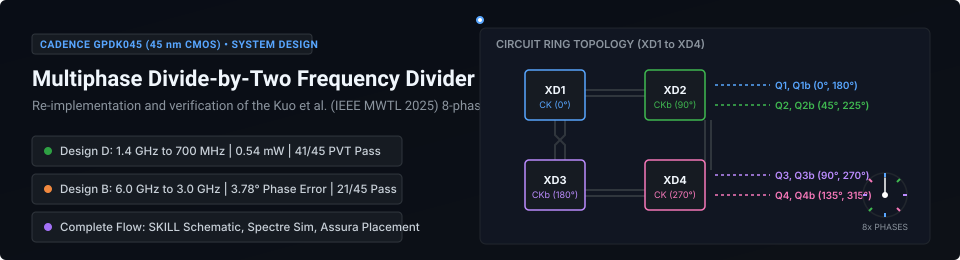
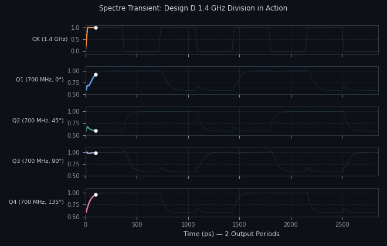
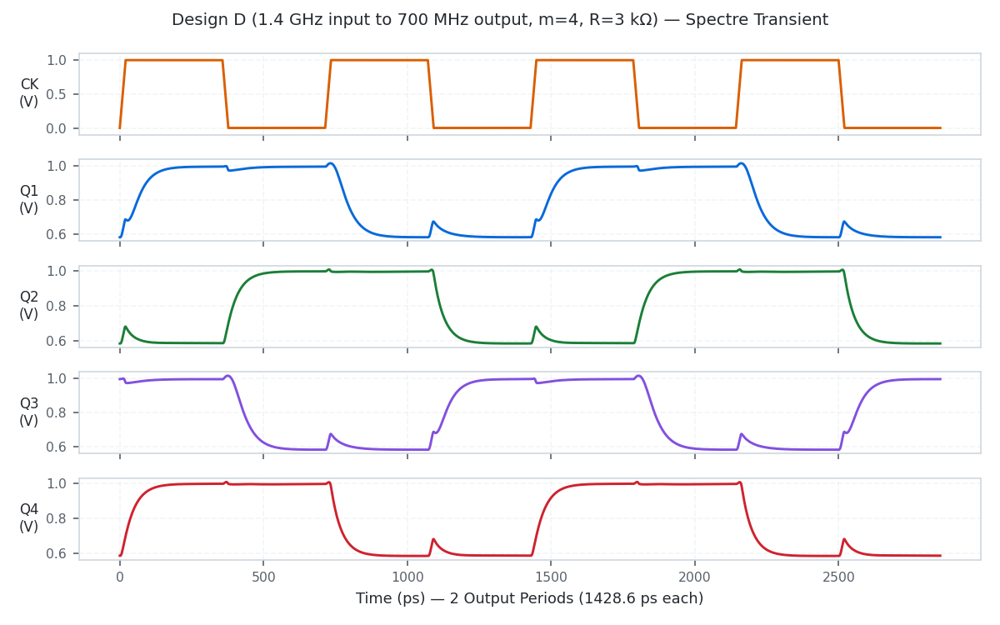
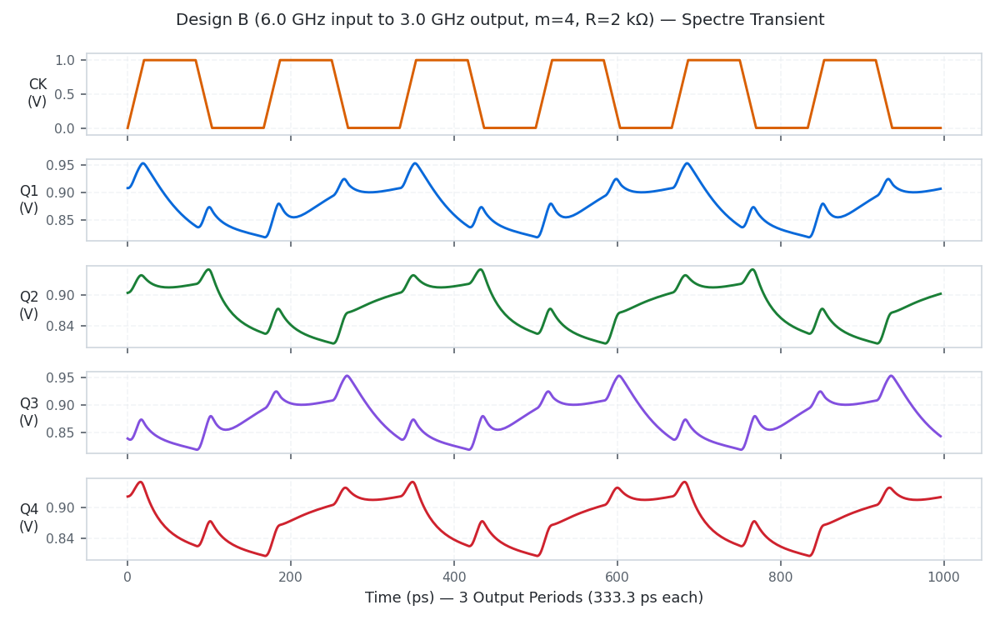
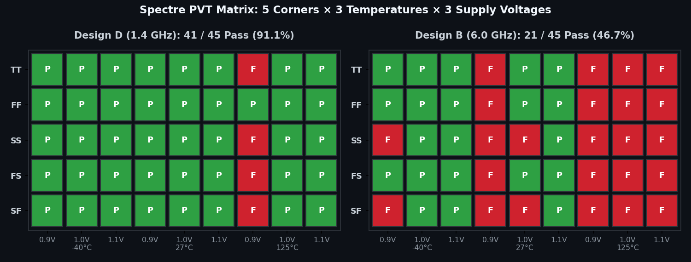
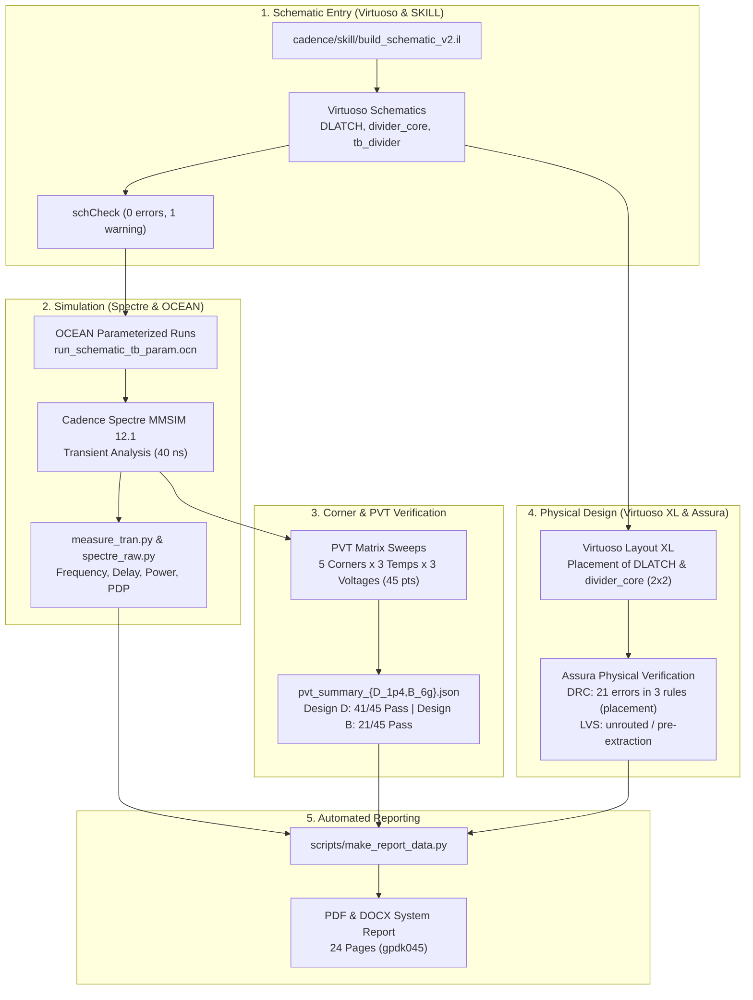
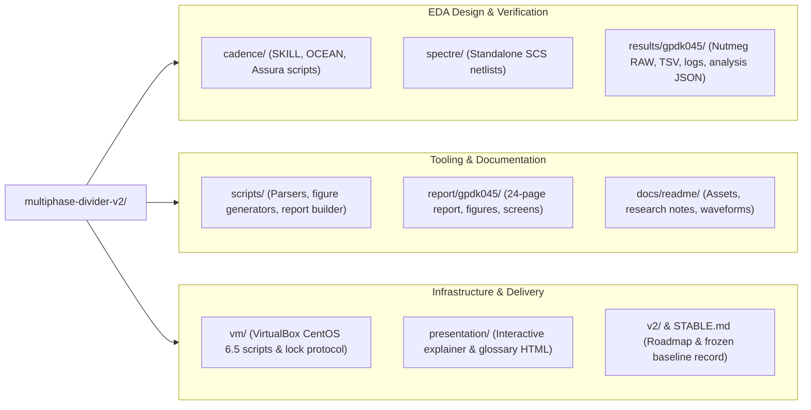

# Multiphase Divide-by-Two CMOS Frequency Divider (Cadence GPDK045)

<p align="center">
  
  <br>
  <em>Architecture illustration: 4-stage differential D-latch ring topology with alternating clock connections producing eight uniform phases (not raw layout geometry).</em>
</p>

<p align="center">
  
  
  
  
  
  
</p>

This repository contains the Cadence GPDK045 (45 nm CMOS) re-implementation and verification of the compact 8-phase divide-by-two frequency divider by Kuo et al. (IEEE MWTL, May 2025). The circuit uses four differential D-latches in a ring with alternating clock connections to produce eight uniformly spaced clock phases at 1.0 V nominal supply. Schematics were constructed in Virtuoso with SKILL, transient and PVT sweeps were evaluated with Spectre and OCEAN, and layout placement was verified using Assura DRC.

## Table of Contents

- [Stable Baseline](#stable-baseline)
- [Results Summary](#results-summary)
- [Division in Action](#division-in-action)
- [Corner and PVT Verification](#corner-and-pvt-verification)
- [Sizing Rationale and Theory](#sizing-rationale-and-theory)
- [What Is and Is Not Done](#what-is-and-is-not-done)
- [End-to-End Design Flow](#end-to-end-design-flow)
- [Repository Map](#repository-map)
- [How to Reproduce](#how-to-reproduce)
- [Documents to Read](#documents-to-read)
- [v2 Direction](#v2-direction)
- [Tools and Versions](#tools-and-versions)
- [Licence and Credit](#licence-and-credit)

## Stable Baseline

The v1.0 baseline is complete and frozen. Refer to [STABLE.md](STABLE.md) for details, checksums, and restoration commands.

- Git tag: `v1.0-stable`
- Git branch: `stable/v1`
- VM snapshot: `stable-v1` (VirtualBox VM `CadenceVM`, powered off)
- Report file: [report/gpdk045/System_Design_Project_Report_gpdk045.pdf](report/gpdk045/System_Design_Project_Report_gpdk045.pdf)

## Results Summary

Metrics were simulated with Cadence Spectre at typical conditions (tt corner, 27 °C, VDD = 1.0 V) unless specified. Values are recorded in [report/gpdk045/report_data.json](report/gpdk045/report_data.json) and [results/gpdk045/final/analysis.json](results/gpdk045/final/analysis.json).

| Circuit | Input Freq. | Output Freq. | Power | Delay | PDP | Phase Error | PVT Pass Rate |
|---|---|---|---|---|---|---|---|
| Unsized baseline (m=1, R=8 kΩ) | 1.4 GHz | 700.0 MHz |  0.1375 mW |  62.21 ps |  8.557 fJ | 26.42° |  Not swept |
| Design D (m=4, R=3 kΩ) | 1.4 GHz | 700.0 MHz |  0.5413 mW |  25.99 ps |  14.067 fJ | 38.46° |  41 / 45 (91.1%) |
| Design B (m=4, R=2 kΩ) | 6.0 GHz | 3000.0 MHz |  0.4929 mW |  27.94 ps |  13.768 fJ | 3.78° |  21 / 45 (46.7%) |
| Paper-rule circuit (m=1, R=1.15 kΩ) | 1.4 GHz | Fails (2799.8 MHz) |  0.1652 mW | Undefined | Undefined | Undefined |  0 / 1 (fails nominal) |

> [!IMPORTANT]
> The original paper sizing rule ($R = R_{on} / 2 = 1.15\text{ k}\Omega$) fails to divide in 45 nm. The pull-down stack has three NMOS devices in series ($M_5, M_6, M_7$). Latch regeneration requires $R \ge 1.1 \times 3 R_{on} / m = 7.59\text{ k}\Omega$ for $m = 1$.

## Division in Action

All waveform visualisations below are plotted directly from raw Cadence Spectre transient simulations recorded in `results/gpdk045/final/`.

### Animated Division Loop

[](docs/readme/division_action.mp4)

<p align="center">
  <em>Spectre transient simulation: 1.4 GHz clock division into four quadrature outputs for Design D over two full output periods (click image to download the MP4 recording). Plotted from Spectre output.</em>
</p>

### Steady-State Waveform Captures

The following transient plots display input clock $CK$ and output phases $Q_1, Q_2, Q_3, Q_4$. Theme-aware `<picture>` containers automatically switch between dark and light modes.

#### Design D at 1.4 GHz (Nominal Division to 700 MHz)

<picture>
  <source media="(prefers-color-scheme: dark)" srcset="docs/readme/waveform_D_1p4GHz_dark.png">
  
</picture>

<p align="center">
  <em>Design D (1.4 GHz input to 700.0 MHz output, m=4, R=3 kΩ, tt corner, 27 °C, VDD=1.0 V). Plotted from Spectre output.</em>
</p>

#### Design B at 6.0 GHz (High-Frequency Division to 3.0 GHz)

<picture>
  <source media="(prefers-color-scheme: dark)" srcset="docs/readme/waveform_B_6GHz_dark.png">
  
</picture>

<p align="center">
  <em>Design B (6.0 GHz input to 3000.0 MHz output, m=4, R=2 kΩ, tt corner, 27 °C, VDD=1.0 V). Plotted from Spectre output.</em>
</p>

## Corner and PVT Verification

The divider was evaluated across a 45-point PVT matrix: 5 process corners (`tt`, `ff`, `ss`, `fs`, `sf`), 3 temperatures (-40 °C, 27 °C, 125 °C), and 3 supply voltages (0.9 V, 1.0 V, 1.1 V).

<p align="center">
  
  <br>
  <em>Pass and fail status across all 45 PVT conditions for Design D (1.4 GHz, 41/45 pass) and Design B (6.0 GHz, 21/45 pass). Generated from results/gpdk045/final/pvt_*.tsv.</em>
</p>

- **Design D (1.4 GHz)** passes 41 of 45 corners (91.1%). The only failures occur at extreme high temperature (125 °C) under minimum supply voltage (0.9 V) across `tt`, `ss`, `fs`, and `sf` corners. All corners pass at nominal (1.0 V) and high (1.1 V) supplies.
- **Design B (6.0 GHz)** passes 21 of 45 corners (46.7%). It achieves uniform phase error (3.78°) at nominal conditions, but is sensitive to high temperature (125 °C fails across all supplies) and low supply (0.9 V).

## Sizing Rationale and Theory

In 45 nm CMOS (Cadence GPDK045), each differential D-latch stage contains seven NMOS transistors and two load resistors:

- Input sampling pair: $M_1, M_2$ ($W = 240\text{ nm}, L = 45\text{ nm}$)
- Cross-coupled latch pair: $M_3, M_4$ ($W = 240\text{ nm}, L = 45\text{ nm}$)
- Clock switching pair: $M_5, M_6$ ($W = 240\text{ nm}, L = 45\text{ nm}$)
- Tail bias transistor: $M_7$ ($W = 480\text{ nm}, L = 90\text{ nm}$)
- Load resistors: $R_1, R_2$

Because the regenerative pull-down stack places three NMOS transistors in series ($M_3/M_4$, $M_5/M_6$, and $M_7$), the effective pull-down on-resistance is:

$$R_{stack} \approx 3 R_{on}$$

To guarantee positive loop gain for latch regeneration ($\left| A_v \right| = g_m R > 1$), the load resistance must satisfy:

$$R \ge 1.1 \times \frac{3 R_{on}}{m}$$

For unit device width ($m = 1$), $R_{on} \approx 2.3\text{ k}\Omega$, requiring $R \ge 7.59\text{ k}\Omega$. The original paper sizing rule ($R = R_{on} / 2 = 1.15\text{ k}\Omega$) provides insufficient regenerative gain, causing latch failure. Setting $m = 4$ reduces stack resistance and allows lowering $R$ to $3\text{ k}\Omega$ (Design D) and $2\text{ k}\Omega$ (Design B), achieving robust toggling up to 6.0 GHz.

## What Is and Is Not Done

> [!WARNING]
> Physical layout for `DLATCH` and `divider_core` (2x2 cell array) is placement only. Automatic routing was completed for 136 of 137 nets but caused 134 DRC errors and LVS mismatches. No LVS-clean routed layout exists in this repository.

> [!NOTE]
> No parasitic RC extraction or post-layout simulation was conducted because the local PDK copy lacks Assura RCX runset rule files. All quantitative metrics are schematic-driven Spectre transient simulations.

> [!NOTE]
> Virtuoso `schCheck` reports zero errors. A single warning remains on `tb_divider` because both the DC voltage source instance and its output net are named `VDD`.

- Layout placement for `DLATCH` and `divider_core` produces 21 Assura DRC errors across 3 rules (substrate well taps and Metal1 minimum area).
- Complete schematic and simulation infrastructure is automated via SKILL and OCEAN scripts.

## End-to-End Design Flow



## Repository Map



| Directory | Description |
|---|---|
| [cadence/](cadence/) | Virtuoso SKILL builders, OCEAN scripts, and Assura verification setups |
| [spectre/](spectre/) | Standalone Spectre netlist (`divider_gpdk45.scs`) for headless runs |
| [scripts/](scripts/) | Python scripts for data consolidation, waveform plotting, and report generation |
| [docs/readme/](docs/readme/) | Local README assets, research documentation, and verified waveform images |
| [results/gpdk045/](results/gpdk045/) | Simulation measurements, raw logs, DRC/LVS reports, and analysis JSON |
| [report/gpdk045/](report/gpdk045/) | Report source data, generated figures, and final PDF/DOCX documents |
| [presentation/](presentation/) | Interactive HTML explainer and project glossary |
| [guide/](guide/) | Cadence GPDK045 student lab manual and walk-throughs |
| [vm/](vm/) | VirtualBox management scripts and VM setup documentation |
| [v2/](v2/) | Project planning documents, requirements, and second-phase roadmaps |
| [legacy/](legacy/) | Early 180 nm ngspice simulation decks and initial experiments |
| [reference/](reference/) | Local reference copies of papers and datasheets (local, git-ignored) |

## How to Reproduce

<details>
<summary><b>1. Host Report Compilation (Python and LibreOffice)</b></summary>

From the repository root on the host system:

```bash
python3 scripts/make_report_data.py
```

This updates [report/gpdk045/report_data.json](report/gpdk045/report_data.json) from `results/gpdk045/final/` and compiles the final report PDF and DOCX.
</details>

<details>
<summary><b>2. Cadence Virtuoso and SKILL Schematic Construction</b></summary>

Inside the Cadence VM guest:

1. Start Virtuoso:
   ```bash
   cd ~/cds_work && virtuoso &
   ```
2. Build schematics from SKILL:
   ```lisp
   load("cadence/skill/build_schematic_v2.il")
   ```
</details>

<details>
<summary><b>3. Schematic-Driven OCEAN and Spectre Simulation</b></summary>

Run schematic-driven Spectre simulation via OCEAN inside the VM:

```bash
cd ~/cds_work && ocean -nograph < cadence/ocean/run_schematic_tb_param.ocn
```
</details>

<details>
<summary><b>4. Standalone Spectre Headless Sweeps</b></summary>

Run standalone Spectre sweeps directly:

```bash
cd ~/gpdk_run && ./run_gpdk045.sh . pvt
```
</details>

<details>
<summary><b>5. Assura DRC and LVS Verification</b></summary>

Run Assura physical checks:

```bash
cadence/skill/verify/run_verify.sh DLATCH drc
cadence/skill/verify/run_verify.sh DLATCH lvs
```
</details>

<details>
<summary><b>6. VirtualBox VM Serial Lock Protocol</b></summary>

> [!CAUTION]
> The Cadence VM runs CentOS 6.5 in VirtualBox without network sharing. Host scripts send guest commands through a virtual serial port (`/dev/ttyS0`) using `VBoxManage controlvm CadenceVM keyboardputstring`, and monitor `/home/parshu/vm/serial.txt` for completion tokens. Because there is only one virtual keyboard channel, simultaneous commands corrupt input. All host jobs must run under the lock:

```bash
flock /home/parshu/vm/vm.lock <command>
```
</details>

<details>
<summary><b>7. Re-generating README Assets</b></summary>

To re-generate all SVG badges, hero banner, waveforms, GIF, MP4, and PVT matrix:

```bash
python3 scripts/make_readme_assets.py
```
</details>

## Documents to Read

- [Final Project Report (PDF)](report/gpdk045/System_Design_Project_Report_gpdk045.pdf): comprehensive 24-page report with sizing analysis, circuit schematics, and PVT data.
- [Presentation Explainer](presentation/explainer.html): interactive web document detailing circuit operation, latch theory, and simulation results.
- [Project Glossary](presentation/glossary.html): glossary of design metrics, simulation parameters, and Cadence tools.
- [README Presentation Research](docs/readme/RESEARCH.md): evaluation of GitHub README rendering capabilities, adopted techniques, and rejected approaches.
- [v2 Plan](v2/PLAN.md): engineering roadmap, stage gates, and decisions for the next project phase.

## v2 Direction

1. v2 focuses on a peer-reviewed letter on the 45 nm divider re-implementation and one measured enhancement.
2. The recommended path in [v2/PLAN.md](v2/PLAN.md) is a systematic sizing exploration rather than complex topology changes.
3. Every reported metric must trace directly to an automated, rerunnable Spectre or Assura artifact.
4. The early draft in [v2/legacy_draft/](v2/legacy_draft/) contains speculative, unmeasured numbers and is unverified.
5. Next steps will proceed only after deciding on the enhancement path, publication venue, and extraction files.

## Tools and Versions

- Cadence Virtuoso IC615 (version 6.1.5)
- Cadence Spectre Circuit Simulator (MMSIM 12.1)
- Cadence Assura Physical Verification (version 4.1)
- Cadence GPDK045 Process Design Kit (version 6.0)
- Oracle VirtualBox with CentOS 6.5 x86 guest (VM name `CadenceVM`)
- Python 3 with `numpy`, `matplotlib`, `python-docx`, and `Pillow`
- LibreOffice (used for PDF export)
- FFmpeg (used for README asset video conversion)

## Licence and Credit

The frequency divider architecture is from:
Yue-Fang Kuo, Shih-Hung Lin, Bo-Yi Chen, and Liang-Chen Liu, "A Compact Multiphase Divide-by-Two CMOS Frequency Divider," *IEEE Microwave and Wireless Technology Letters*, vol. 35, no. 5, pp. 617-620, May 2025, doi: 10.1109/LMWT.2025.3528863.

The original paper PDF is copyrighted by IEEE and is not distributed in this repository.
